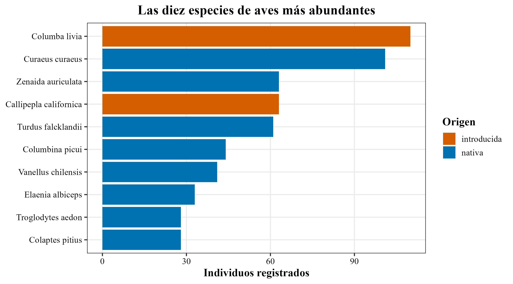
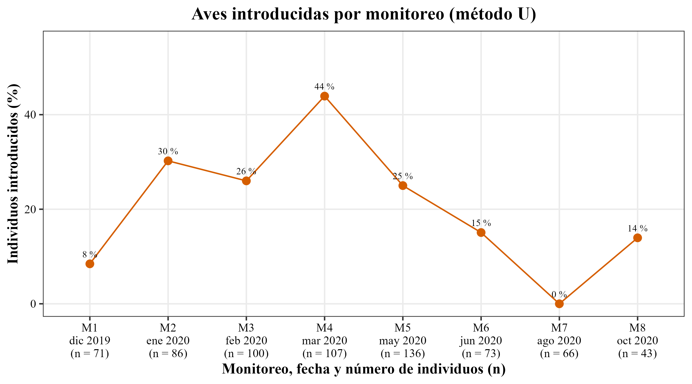

```{r}
#| include: false
library(tidyverse)
library(here)
library(knitr)

aves <- read_csv(here("datos", "processed", "aves_paine_ocurrencias_limpio.csv"))

ordenes_rapaces <- c("Accipitriformes", "Falconiformes", "Strigiformes")
fmt <- function(x, d = 0) format(round(x, d), decimal.mark = ",", nsmall = d)

total_ind <- sum(aves$individualCount)
n_esp <- n_distinct(aves$species)
n_mon <- n_distinct(aves$monitoreo)
pct_intro <- 100 * sum(aves$individualCount[aves$origen == "introducida"]) / total_ind

ranking <- aves %>%
  group_by(species, origen) %>%
  summarise(ind = sum(individualCount), .groups = "drop") %>%
  arrange(desc(ind))
primera <- ranking[1, ]
segunda <- ranking[2, ]

rap <- aves %>% filter(order %in% ordenes_rapaces)
pct_rap <- 100 * sum(rap$individualCount) / total_ind
n_rap_esp <- n_distinct(rap$species)
rap_mon <- rap %>%
  group_by(species) %>%
  summarise(monitoreos = n_distinct(monitoreo), ind = sum(individualCount), .groups = "drop") %>%
  arrange(desc(monitoreos), desc(ind))
rap_top <- rap_mon[1, ]
n_nocturnas_mon <- aves %>% filter(metodo == "N") %>% summarise(n_distinct(monitoreo)) %>% pull()
n_borde_mon <- rap %>% filter(metodo == "E") %>% summarise(n_distinct(monitoreo)) %>% pull()

intro_u <- aves %>%
  filter(metodo == "U") %>%
  group_by(monitoreo) %>%
  summarise(pct = 100 * sum(individualCount[origen == "introducida"]) / sum(individualCount),
            .groups = "drop")
max_intro <- intro_u %>% slice_max(pct, n = 1)
min_intro <- intro_u %>% slice_min(pct, n = 1)
```

## Introducción

Las plagas de roedores causan pérdidas en la producción agrícola, y las aves rapaces ofrecen una forma ecológica de reducirlas que, además, mantiene la biodiversidad local. Por eso el Proyecto GEF Montaña del Ministerio del Medio Ambiente fomenta el control de plagas con rapaces en predios agrícolas. Este informe analiza los datos de aves de uno de esos predios, El Almendral, un huerto de paltos y almendros en Paine [@alvarado2021]. Los datos son públicos (GBIF, licencia CC BY 4.0).

## Resumen

El huerto sí cuenta con rapaces: se registraron `r n_rap_esp` especies, que suman el `r fmt(pct_rap)` % de los individuos. Una de ellas, *`r rap_top$species`*, aparece en los `r n_mon` monitoreos, y las rapaces nocturnas, entre ellas la lechuza blanca (*Tyto alba*), tienen registros en tres monitoreos (M5, M7 y M8). En cambio, la comunidad de aves del huerto está dominada por especies comunes, y la más abundante es una introducida, la paloma doméstica. Estos datos muestran qué aves están presentes y cuándo, pero no cuántas presas consumen, así que no permiten decir si alcanzan para controlar roedores.

## Pregunta de investigación

**¿Cuenta el huerto con las aves que necesita el control de plagas con rapaces, y quién domina su comunidad de aves?**

### Objetivos

1. Identificar qué especies dominan el huerto y cuáles son nativas o introducidas.
2. Describir qué rapaces aparecen en cada monitoreo.

## Datos y diseño de muestreo

El conjunto contiene `r nrow(aves)` registros de `r n_esp` especies (`r n_rap_esp` rapaces y `r n_esp - n_rap_esp` no rapaces), con `r total_ind` individuos en `r n_mon` monitoreos entre diciembre de 2019 y octubre de 2020. Se usaron tres métodos de muestreo (@tbl-metodos), y el esfuerzo cambió durante el estudio (puntos, radio y tiempo). Las fechas y el tamaño de cada monitoreo se resumen en la @tbl-monitoreos.

::: {.callout-note}
## Cómo leer las comparaciones
Como el esfuerzo cambió, los monitoreos solo se comparan dentro de un mismo método. El método U[^metodo-u] es el único presente en los ocho monitoreos.
:::

[^metodo-u]: Censos de aves no rapaces diurnas, dentro de la plantación.

::: {.panel-tabset}

### Por método

```{r}
#| label: tbl-metodos
#| tbl-cap: "Registros, individuos, especies y monitoreos por método de muestreo."
aves %>%
  mutate(metodo = case_when(
    metodo == "U" ~ "U: aves no rapaces, dentro de la plantación",
    metodo == "E" ~ "E: rapaces diurnas, borde plantación-bosque",
    metodo == "N" ~ "N: rapaces nocturnas, con playback",
    TRUE ~ metodo
  )) %>%
  group_by(metodo) %>%
  summarise(
    registros = n(),
    individuos = sum(individualCount),
    especies = n_distinct(species),
    monitoreos = n_distinct(monitoreo),
    .groups = "drop"
  ) %>%
  kable(col.names = c("Método", "Registros", "Individuos", "Especies", "Monitoreos"))
```

### Por monitoreo

```{r}
#| label: tbl-monitoreos
#| tbl-cap: "Fecha, individuos y especies registradas en cada monitoreo, con todos los métodos juntos."
aves %>%
  group_by(monitoreo) %>%
  summarise(
    fecha = as.character(min(as.Date(eventDate))),
    individuos = sum(individualCount),
    especies = n_distinct(species),
    .groups = "drop"
  ) %>%
  arrange(fecha) %>%
  kable(col.names = c("Monitoreo", "Fecha", "Individuos", "Especies (todos los métodos)"))
```

:::

## Esfuerzo de muestreo

La tabla de eventos del archivo original registra cada visita a un punto: son 122 eventos, y 112 de ellos tienen aves. Los 10 restantes (siete del método E y tres del N) son visitas sin registros, que no aparecen en la tabla de ocurrencias y que se recuperan al unir ambas tablas. Los puntos del método U siempre tuvieron aves.

El esfuerzo cambió durante el estudio. En el método U, los primeros tres monitoreos usaron un radio de 200 m y 10 minutos por punto, y desde M4 pasaron a 50 m y 5 minutos. Además, el punto U7 se dejó de visitar después de M4 y fue reemplazado por U11 desde M5. Los puntos del método E fueron seis en M1 y M2, y tres en los monitoreos siguientes. Las rapaces nocturnas (N) solo se buscaron en M5, M7 y M8, y en nueve de esas 12 visitas hubo al menos un registro (@fig-esfuerzo).

{#fig-esfuerzo fig-alt="Mapa de calor del número de eventos de muestreo por método (U, N y E) y monitoreo (M1 a M8). El método U tiene 10 de 10 eventos con aves en todos los monitoreos; el N solo se usó en M5, M7 y M8; el E tuvo 6 eventos en M1 y M2 y 3 en los siguientes."}

## Hallazgo 1: la especie más abundante es introducida

La especie más abundante es la paloma doméstica (*`r primera$species`*, `r primera$origen`), con `r primera$ind` individuos, seguida de cerca por un tordo nativo (*`r segunda$species`*, `r segunda$origen`), con `r segunda$ind`. En total, las especies introducidas son el `r fmt(pct_intro, 1)` % de los individuos, y las rapaces apenas el `r fmt(pct_rap)` % (@fig-dominancia).

{#fig-dominancia fig-alt="Gráfico de barras horizontales con las diez especies más abundantes. Columba livia, introducida, encabeza el ranking, seguida de Curaeus curaeus, nativa. Callipepla californica es la otra especie introducida entre las diez."}

Dentro de la plantación (método U), la proporción de individuos introducidos varía entre monitoreos: va de `r fmt(min_intro$pct, 0)` % en `r min_intro$monitoreo` a `r fmt(max_intro$pct, 0)` % en `r max_intro$monitoreo` (@fig-introducidas). Es decir, los introducidos llegan a cerca de la mitad de los individuos en un monitoreo y no aparecen en otro. Como cada monitoreo tiene pocos individuos, conviene mirar el tamaño de muestra (n) de cada punto.

{#fig-introducidas fig-alt="Gráfico de líneas con el porcentaje de individuos introducidos por monitoreo en el método U: 8 % en M1, 30 % en M2, 26 % en M3, 44 % en M4, 25 % en M5, 15 % en M6, 0 % en M7 y 14 % en M8."}

## Hallazgo 2: qué rapaces aparecen y cuándo

Se registraron `r n_rap_esp` especies de rapaces. La única presente en los ocho monitoreos es *`r rap_top$species`* (`r rap_top$monitoreos` de `r n_mon`), con `r rap_top$ind` individuos. Las rapaces nocturnas solo tienen registros en `r n_nocturnas_mon` monitoreos (M5, M7 y M8); según la tabla de eventos, solo se buscaron en esos tres, así que en los demás monitoreos no hubo muestreo y no corresponde hablar de ausencia.

Entre las rapaces diurnas hay un recambio durante el año. *Parabuteo unicinctus* (13 de sus 18 individuos) y *Milvago chimango* (12 de 16) se registran sobre todo entre M1 y M4, *Geranoaetus melanoleucus* se mantiene en todos los monitoreos, y *Vultur gryphus* se concentra en M8 (5 de 8 individuos). Son pocos individuos por celda, así que hay que leerlo como un patrón y no como una conclusión, sobre todo porque en M1 y M2 hubo el doble de puntos de rapaces diurnas que después (@fig-rapaces).

{#fig-rapaces fig-alt="Mapa de calor con el número de individuos de nueve especies de rapaces por monitoreo. Geranoaetus melanoleucus aparece en los ocho monitoreos. Bubo magellanicus y Tyto alba solo tienen registros en M5, M7 y M8."}

## Discusión

El análisis sugiere que el huerto tiene una comunidad de aves dominada por especies comunes y en parte introducidas, con rapaces presentes pero poco numerosas. Estos resultados son descriptivos: no hay datos de presas ni de plagas, así que no se puede evaluar si las rapaces controlan efectivamente los roedores.

::: {.callout-warning}
## Esfuerzo de muestreo desigual
El esfuerzo cambió durante el estudio (radio y tiempo en el método U, número de puntos en el E). En particular, la @fig-introducidas junta monitoreos con distinto esfuerzo, así que sus diferencias pueden deberse en parte al método de conteo.
:::

Gracias a la tabla de eventos se distingue un cero real de un monitoreo sin esfuerzo, y por eso las comparaciones se hicieron dentro de un mismo método.

## Conclusión

Este primer borrador describe la comunidad de aves de un huerto de paltos y almendros de Paine, donde la especie más abundante es introducida y una sola rapaz aparece en todos los monitoreos.

Los próximos pasos son sumar los datos de murciélagos del mismo predio, comparar la riqueza de especies entre monitoreos (con rarefacción) y mejorar el diseño de las figuras.

## Referencias {.unnumbered}

::: {#refs}
:::
