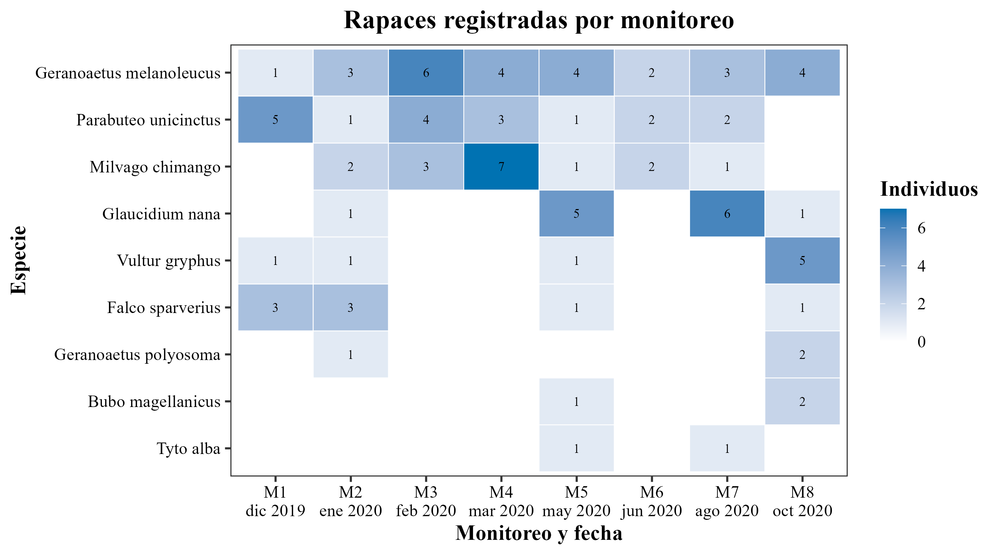

```{r}
library(tidyverse)
library(here)
library(knitr)

aves <- read_csv(here("datos", "processed", "aves_paine_ocurrencias_limpio.csv"))

ordenes_rapaces <- c("Accipitriformes", "Falconiformes", "Strigiformes")
fmt <- function(x, d = 0) format(round(x, d), decimal.mark = ",", nsmall = d)

total_ind <- sum(aves$individualCount)
n_esp <- n_distinct(aves$species)
n_mon <- n_distinct(aves$monitoreo)
pct_intro <- 100 * sum(aves$individualCount[aves$origen == "introducida"]) / total_ind

ranking <- aves %>%
  group_by(species, origen) %>%
  summarise(ind = sum(individualCount), .groups = "drop") %>%
  arrange(desc(ind))
primera <- ranking[1, ]
segunda <- ranking[2, ]

rap <- aves %>% filter(order %in% ordenes_rapaces)
pct_rap <- 100 * sum(rap$individualCount) / total_ind
n_rap_esp <- n_distinct(rap$species)
rap_mon <- rap %>%
  group_by(species) %>%
  summarise(monitoreos = n_distinct(monitoreo), ind = sum(individualCount), .groups = "drop") %>%
  arrange(desc(monitoreos), desc(ind))
rap_top <- rap_mon[1, ]
n_nocturnas_mon <- aves %>% filter(metodo == "N") %>% summarise(n_distinct(monitoreo)) %>% pull()
n_borde_mon <- rap %>% filter(metodo == "E") %>% summarise(n_distinct(monitoreo)) %>% pull()

intro_u <- aves %>%
  filter(metodo == "U") %>%
  group_by(monitoreo) %>%
  summarise(pct = 100 * sum(individualCount[origen == "introducida"]) / sum(individualCount),
            .groups = "drop")
max_intro <- intro_u %>% slice_max(pct, n = 1)
min_intro <- intro_u %>% slice_min(pct, n = 1)
```

## Introducción

Las plagas de roedores causan pérdidas en la producción agrícola, y las aves rapaces ofrecen una forma ecológica de reducirlas que, además, mantiene la biodiversidad local. Por eso el Proyecto GEF Montaña del Ministerio del Medio Ambiente fomenta el control de plagas con rapaces en predios agrícolas. Este informe analiza los datos de aves de uno de esos predios, El Almendral, un huerto de paltos y almendros en Paine (Alvarado Orellana et al. 2021, GBIF, licencia CC BY 4.0).

## Resumen

El huerto sí cuenta con rapaces: se registraron `r n_rap_esp` especies, que suman el `r fmt(pct_rap)` % de los individuos. Una de ellas, *`r rap_top$species`*, aparece en los `r n_mon` monitoreos, y las rapaces nocturnas, entre ellas la lechuza blanca (*Tyto alba*), tienen registros en tres monitoreos (M5, M7 y M8). En cambio, la comunidad de aves del huerto está dominada por especies comunes, y la más abundante es una introducida, la paloma doméstica. Estos datos muestran qué aves están presentes y cuándo, pero no cuántas presas consumen, así que no permiten decir si alcanzan para controlar roedores.

## Pregunta de investigación

**¿Cuenta el huerto con las aves que necesita el control de plagas con rapaces, y quién domina su comunidad de aves?**

### Objetivos

1. Identificar qué especies dominan el huerto y cuáles son nativas o introducidas.
2. Describir qué rapaces aparecen en cada monitoreo.

## Datos y diseño de muestreo

El conjunto contiene `r nrow(aves)` registros de `r n_esp` especies (`r n_rap_esp` rapaces y `r n_esp - n_rap_esp` no rapaces), con `r total_ind` individuos en `r n_mon` monitoreos entre diciembre de 2019 y octubre de 2020. Se usaron tres métodos de muestreo, y el esfuerzo cambió durante el estudio (puntos, radio y tiempo), por lo que los monitoreos solo se comparan dentro de un mismo método.

```{r}
aves %>%
  mutate(metodo = case_when(
    metodo == "U" ~ "U: aves no rapaces, dentro de la plantación",
    metodo == "E" ~ "E: rapaces diurnas, borde plantación-bosque",
    metodo == "N" ~ "N: rapaces nocturnas, con playback",
    TRUE ~ metodo
  )) %>%
  group_by(metodo) %>%
  summarise(
    registros = n(),
    individuos = sum(individualCount),
    especies = n_distinct(species),
    monitoreos = n_distinct(monitoreo),
    .groups = "drop"
  ) %>%
  kable(col.names = c("Método", "Registros", "Individuos", "Especies", "Monitoreos"))
```

*Tabla 1. Registros, individuos, especies y monitoreos por método de muestreo.*

```{r}
aves %>%
  group_by(monitoreo) %>%
  summarise(
    fecha = as.character(min(as.Date(eventDate))),
    individuos = sum(individualCount),
    especies = n_distinct(species),
    .groups = "drop"
  ) %>%
  arrange(fecha) %>%
  kable(col.names = c("Monitoreo", "Fecha", "Individuos", "Especies (todos los métodos)"))
```

*Tabla 2. Fecha, individuos y especies registradas en cada monitoreo, con todos los métodos juntos.*

## Hallazgo 1: la especie más abundante es introducida

La especie más abundante es la paloma doméstica (*`r primera$species`*, `r primera$origen`), con `r primera$ind` individuos, seguida de cerca por un tordo nativo (*`r segunda$species`*, `r segunda$origen`), con `r segunda$ind`. En total, las especies introducidas son el `r fmt(pct_intro, 1)` % de los individuos, y las rapaces apenas el `r fmt(pct_rap)` %.


Dentro de la plantación (método U), la proporción de individuos introducidos varía entre monitoreos: va de `r fmt(min_intro$pct, 0)` % en `r min_intro$monitoreo` a `r fmt(max_intro$pct, 0)` % en `r max_intro$monitoreo`. Es decir, los introducidos llegan a cerca de la mitad de los individuos en un monitoreo y no aparecen en otro. Como cada monitoreo tiene pocos individuos, conviene mirar el tamaño de muestra (n) de cada punto.


## Hallazgo 2: qué rapaces aparecen y cuándo

Se registraron `r n_rap_esp` especies de rapaces. La única presente en los ocho monitoreos es *`r rap_top$species`* (`r rap_top$monitoreos` de `r n_mon`), con `r rap_top$ind` individuos. Las rapaces nocturnas solo tienen registros en `r n_nocturnas_mon` monitoreos (M5, M7 y M8); sin la tabla de eventos no sabemos si se buscaron en los demás, así que su ausencia no significa que no estuvieran.

Entre las rapaces diurnas hay un recambio durante el año. *Parabuteo unicinctus* (13 de sus 18 individuos) y *Milvago chimango* (12 de 16) se registran sobre todo entre M1 y M4, *Geranoaetus melanoleucus* se mantiene en todos los monitoreos, y *Vultur gryphus* se concentra en M8 (5 de 8 individuos). Son pocos individuos por celda, así que es un patrón para revisar con la tabla de eventos y no una conclusión.



## Discusión

El análisis sugiere que el huerto tiene una comunidad de aves dominada por especies comunes y en parte introducidas, con rapaces presentes pero poco numerosas. Estos resultados son descriptivos: no hay datos de presas ni de plagas, así que no se puede evaluar si las rapaces controlan efectivamente los roedores.

Además, el esfuerzo de muestreo cambió durante el estudio y la tabla de eventos (con los monitoreos sin aves) no está incorporada, por lo que no es posible distinguir un cero real de un monitoreo sin esfuerzo. Por eso las comparaciones se hicieron dentro de un mismo método.

## Conclusión

Este primer borrador describe la comunidad de aves de un huerto de paltos y almendros de Paine, donde la especie más abundante es introducida y una sola rapaz aparece en todos los monitoreos.

Los próximos pasos son incorporar la tabla de eventos, sumar los datos de murciélagos del mismo predio, comparar la riqueza de especies entre monitoreos (con rarefacción) y mejorar el diseño de las figuras.
